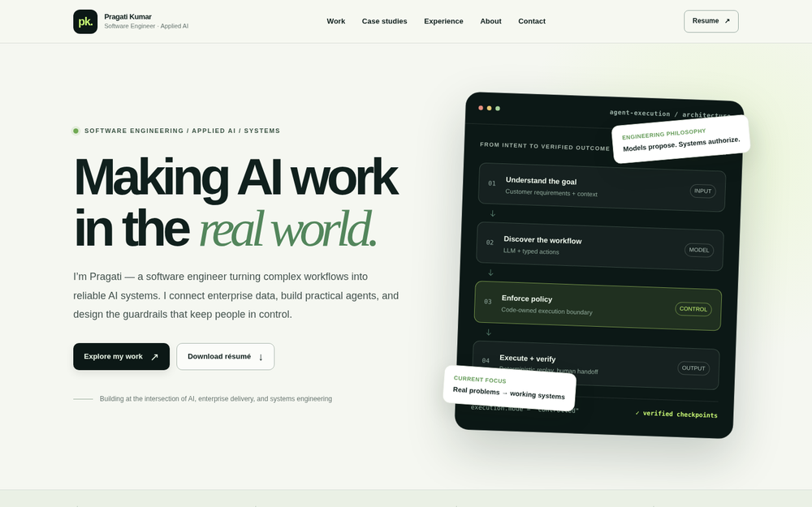

# Pragati Kumar | AI Systems & Enterprise Engineering

I build applied AI systems that solve operational problems — from enterprise knowledge assistants and workflow automation to reliable, controlled agent execution.

My work combines **software engineering, stakeholder requirements, enterprise integration, distributed systems, and agent reliability**. This portfolio highlights the architectures, implementation decisions, and measured outcomes behind selected projects.

**[Live Portfolio](https://pragati1698.github.io/)** · **[LinkedIn](https://www.linkedin.com/in/pragatikr)** · **[GitHub](https://github.com/pragati1698)**

## Website Preview

<a href="https://pragati1698.github.io/">
  
</a>

## Featured Engineering Work

### Agent Hands — Controlled AI Agent Execution

An LLM-assisted browser automation system that discovers workflows, records validated typed capabilities, and replays them through an independent deterministic engine **without additional model calls**. The constrained fictional banking demo includes code-owned policy, checkpoint verification, sanitized evidence, and same-session human handoff.

**Technologies:** Python · Playwright · Pydantic · LLM API · pytest

[Source code](https://github.com/pragati1698/agent-hands) · [Portfolio case study](case-studies/agent-hands.html)

### Enterprise AI Assistants — Applied AI Delivery

Designed and developed enterprise Copilot Studio solutions connecting organizational knowledge and request-routing workflows. Work spans requirements, integration, access considerations, testing, and deployment preparation. **No completed production rollout is claimed.**

**Technologies:** Microsoft Copilot Studio · SharePoint · Power Automate · Enterprise data

[Portfolio case study](case-studies/enterprise-ai.html)

## Experience & Measurable Engineering Impact

- Built Kubernetes-backed Selenium test infrastructure supporting **200 parallel sessions**, reducing one regression workflow from **6 hours to 3 minutes**.
- Created a Python/NLP pipeline analyzing **1,000+ survey responses** for themes and sentiment.
- Built AI and automation integrations using Python, SQL Server, SharePoint, Copilot Studio and Microsoft Power Platform.

Figures reflect prior resume documentation and should be validated against original records before broad external use.

## Education & Professional Development

- **Stanford University — Probability for AI (2026):** Coursework **in progress**. This is a course, not a Stanford degree.
- **Microsoft Copilot Agents Architecture Bootcamp Graduate Badge (September 2026):** Earned a graduate credential issued by **Global AI Community** for the Copilot Agents Architecture Bootcamp. Covers hands-on AI agent architecture and implementation. The issuing organization is Global AI Community.
- **Stevens Institute of Technology:** M.S. Computer Science (2023), GPA 3.9/4.0.
- **Savitribai Phule Pune University:** B.E. Computer Science (2020).
- **AWS Certified Cloud Practitioner:** Previously earned professional credential.

## Project Structure

```text
.
├── index.html
├── README.md
├── .nojekyll
├── case-studies/
│   ├── agent-hands.html
│   └── enterprise-ai.html
└── assets/
    ├── styles.css
    ├── site.js
    ├── favicon.svg
    ├── portfolio-preview.png
    ├── social-preview.png
    └── Pragati_Kumar_Resume.pdf
```

This is a static, dependency-free HTML/CSS/JavaScript website. It requires no app server, build step, external SDK or API key. The `social-preview.png` file powers the LinkedIn/Open Graph sharing thumbnail.

## Run Locally

Open `index.html` in a browser, or from the repository root run:

```bash
python -m http.server 8000
```

Then visit http://localhost:8000/.

## Publish & Update on GitHub Pages

This repository is intended to publish at **https://pragati1698.github.io/**.

1. The repository must be named `pragati1698.github.io`, and `index.html` must be in the **repository root**.
2. Open **Settings → Pages → Build and deployment** and select **Deploy from a branch**, `main`, `/ (root)`.
3. Push or commit changes on `main` to trigger another deployment. No new site or Pages setting is required.
4. When deployment finishes, check the live site, both case studies, and the resume link. Use a hard refresh if your browser shows older content.
5. To update LinkedIn's link preview, refresh its cached preview using [LinkedIn Post Inspector](https://www.linkedin.com/post-inspector/). Existing Featured cards may need to be removed and re-added if LinkedIn doesn't refresh them.

If replacing an existing file through GitHub's web interface, preserve its exact path and filename. For multiple updated files, **GitHub Desktop** is the most reliable method: clone the repository, replace files, commit, and push.

## Update Content

| Content | File |
| --- | --- |
| About, featured work, professional development | `index.html` |
| Website layout, colors, responsive behavior | `assets/styles.css` |
| Navigation and motion | `assets/site.js` |
| Agent Hands technical story | `case-studies/agent-hands.html` |
| Enterprise AI case study | `case-studies/enterprise-ai.html` |
| Public resume download | `assets/Pragati_Kumar_Resume.pdf` |
| GitHub README screenshot | `assets/portfolio-preview.png` |
| LinkedIn/share-card thumbnail | `assets/social-preview.png` and `og:image` in `index.html` |

## Privacy & Accuracy

- Employer-specific descriptions are generalized; do not publish CTDOT source code, internal links, private screenshots, sensitive architecture, secrets or data exports.
- Review employment communications and branding requirements before publishing or expanding a work case study.
- Public-facing resume excludes a personal phone number.
- Stanford coursework is listed as in progress. The **Copilot Agents Architecture Bootcamp Graduate Badge** is attributed to its issuer, **Global AI Community**.
- Describe in-development agents as prototypes/pilots until launch, user validation, and production outcomes are established.

**Building useful AI systems with bounded authority, real integrations, and measurable outcomes.**
